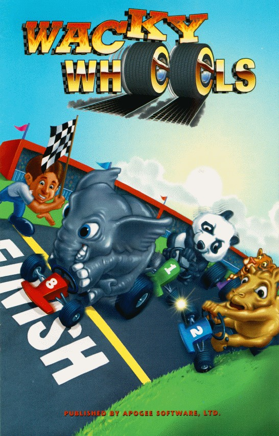
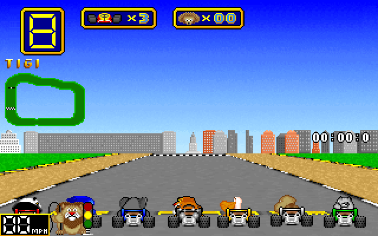
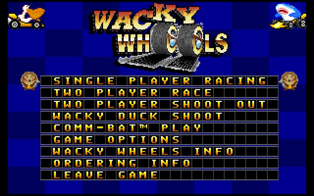
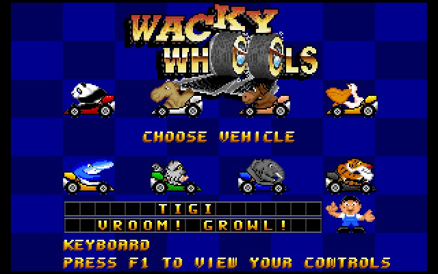
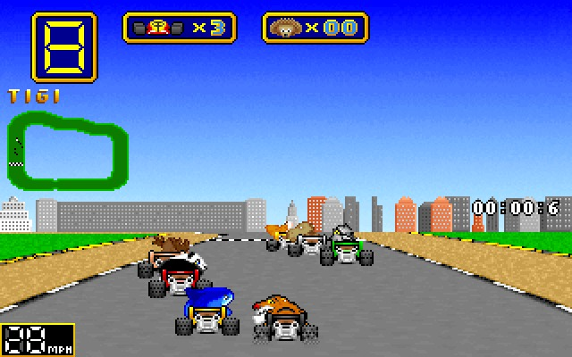
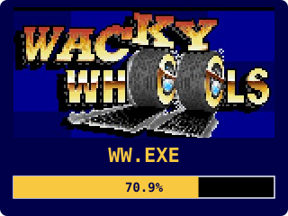

# Wacky Wheels: reverse engineering and decompilation



A study of the DOS kart racer **Wacky Wheels** (Beavis Soft, published by
Apogee Software; version 1.1, registered), and a rebuild of its program in C
that compiles back to the same machine code.



The research half is notes on how the original works, worked out from
`WW.EXE` (Watcom C 9.5b, DOS/4GW) and its data, and from experiments with it
running under DOSBox-X. Each finding records the code addresses it rests on
and how sure it is.

The decompilation is `src/ww.c`, one source file, as the game's own C was.
Built with the compiler and options the game was built with, each function is
compared byte for byte with the original at the same address. A function
counts as done only when the bytes are the same.

<p>
  
  
  
</p>

All of these are the original `WW.EXE`, captured in DOSBox-X.

**The game itself is not included.** You need your own copy. Nothing here
changes or redistributes the original files.

## Progress

<a href="docs/WWPROGRESS.HTML"></a>

**198 of the game's 285 C functions compile to the original's exact bytes.**
83 more are near misses and 4 are not written yet. The game's assembler
module and the libraries are outside that count.

[`docs/WWPROGRESS.HTML`](docs/WWPROGRESS.HTML) lists every function: search it,
filter it by status or subsystem, and click a near miss to see its instruction
diff against the game. [`PROGRESS.md`](PROGRESS.md) has the same numbers as
tables, part by part and by subsystem. `tools/progress.py` writes all three from a fresh build of
the source, not from hand counts.

## Building and checking

The build needs Watcom C/C++ 9.5b, the version the game was built with. It is
not included: `findings/executables.md` names the floppy set and the patch,
and two entries in `harness/TRAPS.md` (the floppies and the 9.5a/9.5b
patches) show how to install it under DOSBox into
`.work/toolchains/inst/WC95B`. The Python tools run from `.work/venv`.

```sh
./setup.sh                      # checks the tools, makes .work/venv
src/check.sh                    # compile src/ww.c, compare every function with WW.EXE
.work/venv/bin/python tools/wc/fndiff.py ww .work/src/WW.OBJ NAME 0xADDR   # the instructions where one function differs
.work/venv/bin/python tools/wc/nmrefs.py ww .work/src/WW.OBJ  # the globals, calls and strings each near miss uses
.work/venv/bin/python tools/progress.py   # rewrite PROGRESS.md
```

`WW.EXE` goes in `original/`, untouched; `original/SHA256SUMS` lists the
files the notes were made with. There is no playable build of `src/ww.c` yet:
it is compared as an object file, function by function.

## Layout

| Path | Contents |
|---|---|
| `src/ww.c` | The decompiled game, one file; each near miss carries a `differs:` note |
| `src/nearmiss.txt` | The near misses, ranked, with what is known about each |
| `findings/` | What has been established about the game, by subsystem, with evidence |
| `analysis/` | Function names with their evidence, the subsystem grouping |
| `QUESTIONS.md` | Open questions and hypotheses |
| `GOTCHAS.md` | Traps in the tools and in matching Watcom's output, and what worked |
| `tools/le/` | LE loader and function finder |
| `tools/wc/` | Compiler driver, function comparison, library matching, near-miss tools |
| `tools/dosrun.py` | Drives the original in DOSBox-X: keys, screenshots, memory, save states |
| `harness/` | DOSBox-X set-up for running the original |

## How the research works

Each finding carries a label: CONFIRMED, STRONGLY SUPPORTED, LIKELY or
SPECULATIVE. The notes never present an inference as fact. Evidence from the
binary and from runtime experiments comes before outside documentation. The
working rules are in [`METHOD.md`](METHOD.md) and [`AGENTS.md`](AGENTS.md).

A matching function proves the C means what the game's code does. A near miss
does not, so `tools/wc/nmrefs.py` checks every near miss for the addresses it
uses: the globals, the functions it calls, the strings and the jump targets.
It has found four near misses that behaved differently from the game, and
those are fixed.

The original runs in a patched DOSBox-X from
[dos-re-suite](https://github.com/berobloom/dos-re-suite), which
`tools/dosrun.py` drives on a hidden display. The pictures above come from
there.

## Status

The game's C is written apart from 4 small functions between 0x1BF80 and 0x1C0F3, and 198 of
its functions match. The next near misses to work on are listed in
`STATUS.md`. Not started: the assembler module (VGA drawing, interrupt
handlers), the sound library, and a build that links into a playable program.

## License

Copyright (C) 2026 Berobloom

This program is free software: you can redistribute it and/or modify it under
the terms of the GNU General Public License as published by the Free Software
Foundation, either version 3 of the License, or (at your option) any later
version. It comes WITHOUT ANY WARRANTY. The full text is in [LICENSE](LICENSE).

It covers this project's own code and notes, not the game.

## Legal

Wacky Wheels, its program, its data and its cover art (Beavis Soft, 1994;
published by Apogee Software, Ltd.) are the property of their rights holders.
The cover image is the front page of the manual on the game's CD,
`FRNTCOVR.PCX`. This project contains no game data and is meant for people
who own the game.
